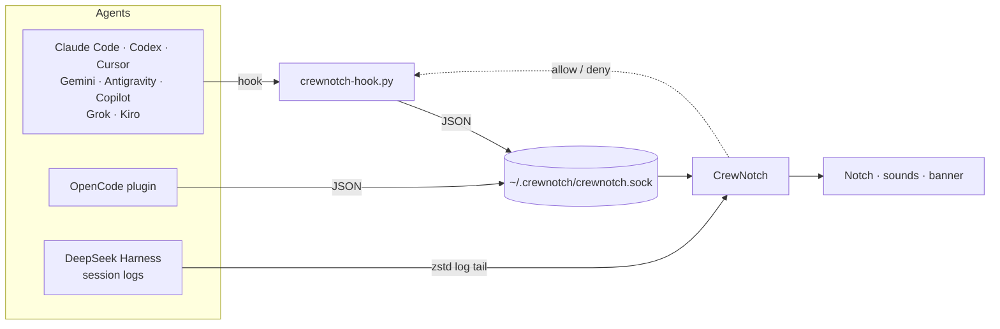

<div align="center">
  

  <p>
    <a href="https://github.com/karabogadev/crewnotch/releases/latest"></a>
    
    
    <a href="LICENSE.md"></a>
  </p>

  <p><strong>Know which agent is working, which one is done, and which one needs you, without leaving what you're doing.</strong></p>

  <p><a href="https://karabogadev.github.io/crewnotch/">Website</a> · <a href="#install">Install</a> · <a href="https://github.com/karabogadev/crewnotch/issues">Report an issue</a></p>
</div>

---

You run Claude Code in one terminal, Codex in another, Cursor and Antigravity in their own windows, and a DeepSeek Harness session in the background. One of them finished ten minutes ago. Another has been waiting on an approval the whole time.

**CrewNotch puts all of them in the notch.** The notch quietly shows the busiest agent while your crew works. It tells you the moment a turn finishes or an agent asks for permission, and one click takes you back to the right terminal or window.

## Highlights

- **Every agent in one place.** Claude Code, Codex, Cursor, Gemini CLI, Antigravity, DeepSeek Harness, OpenCode, Copilot CLI, Grok and Kiro. Each one shows up with its own logo.
- **Working, done, needs you, at a glance.** The closed notch shows the agent that matters most right now, plus a status mark: working, finished or waiting on you.
- **Approve from the notch, knowing what you approve.** Allow or deny Claude Code, Codex and OpenCode requests without switching windows. You see the whole command or the diff first. Deleting files, force-pushing, `sudo` and similar requests get a red warning. **Always** saves the rule the agent suggests so it stops asking.
- **Answer questions in the notch.** When Claude Code asks you to pick an option, click it, tick several, or type your own answer.
- **Keyboard first.** A global shortcut (⌃⌥N by default) opens the notch. Then ⌘↩ allows, ⌘⇧↩ always allows, ⌘⌫ denies, 1–9 picks an answer and ⎋ closes.
- **More in every row.** The git branch, how full the context window is (Claude Code, Codex), the agent's own to-do progress (*3/7 · Writing tests*), and a heads-up when a working session has gone quiet.
- **A finished banner.** When an agent finishes and you're looking elsewhere, the notch drops down for a moment: *Finished · storefront · Open ↗*.
- **Back in one click.** Double-click a session to bring its terminal (or tmux pane, with yabai) or app window to the front.
- **Plan usage in the notch.** Session, weekly and per-model limits for Claude, Codex, Antigravity, Cursor, Copilot, Grok, OpenCode Go and Kiro, with no separate app. The notch tells you when a limit runs low and when it resets.
- **Notifications when you're away.** macOS notifications and pushes to your phone through [ntfy](https://ntfy.sh), always or only after you've stepped away from the Mac. Both are off until you turn them on.
- **Any command in the notch.** `crewnotch run npm test` shows a long command as working and tells you when it finishes or fails.
- **Pick up where you left off.** Recently ended sessions stay at the bottom of the list, and **Resume** reopens the conversation in a terminal.
- **Token history.** Tokens per day across agents, the estimated API value of your Claude usage, and your busiest day. Share it as an image.
- **Keep Awake.** Agents keep running when the display sleeps or the screen locks. It works on power adapter only, stops below a battery threshold and turns itself off after a time limit.
- **Light or dark.** A light and a dark theme for the panel and windows, or follow the system. The closed notch always stays black.
- **Make it yours.** Six working indicators, notch animations, materials and colors, sounds per event, text size and much more.
- **Updates itself.** Checks for new versions daily and installs them in one click, or fully automatically if you prefer. Every update is signed and verified.
- **Private by design.** No account and no analytics. Everything stays on your Mac, and you can hide the notch from screen sharing and recordings.
- **Speaks your language.** English, 简体中文, हिन्दी, Español, Français, العربية, Português (Brasil), Русский, 日本語 and Türkçe. Switch any time in Settings → General.
- **Reply from any terminal.** Type a reply in the notch chat and CrewNotch delivers it to the agent's Ghostty, Terminal, iTerm2 or tmux session.

## Supported agents

| Agent | How CrewNotch connects | Live status | Approve from notch | Plan usage |
|---|---|:-:|:-:|:-:|
| **Claude Code** | Hooks in `~/.claude/settings.json` | ✓ | ✓ | ✓ |
| **Codex** | Hooks in `~/.codex/hooks.json` | ✓ | ✓ | ✓ |
| **Cursor** | Hooks in `~/.cursor/hooks.json` | ✓ | | ✓ |
| **Gemini CLI** | Hooks in `~/.gemini/settings.json` | ✓ | | |
| **Antigravity** (app and IDE) | A named hook in `~/.gemini/config/hooks.json` | ✓ | | ✓ |
| **DeepSeek Harness** | Reads its session logs, nothing installed | ✓ | | |
| **OpenCode** | A small plugin in `~/.config/opencode/plugin/` | ✓ | ✓ | ✓ (Go) |
| **Copilot CLI** | Its own file in `~/.copilot/hooks/` | ✓ | | ✓ |
| **Grok** | Its own file in `~/.grok/hooks/` | ✓ | | ✓ |
| **Kiro** | Its own file in `~/.kiro/hooks/` (v3 engine) | ✓ | | ✓ |

Agents without a notch approval still show when they need you, and an **Open** button takes you straight to them. Approvals from the notch need an agent that asks CrewNotch only when it would prompt you. The others' hooks fire on every tool call, so answering there would mean gating every command.

## How it works



- **One small hook script.** Every hook-based agent runs `~/.crewnotch/bin/crewnotch-hook.py --agent <name>`. The script turns that agent's events into the same few states (working, finished, needs you) and sends them to the app over a local socket.
- **Observe-only.** If CrewNotch isn't running, or anything goes wrong, the hook exits quietly and your agent carries on as if it weren't there. Hooks never change an agent's behavior, apart from an approval or answer you give from the notch.
- **Careful with your config.** CrewNotch only adds or removes its own entries. Your settings and other tools' hooks stay exactly as they were.
- **Local socket only.** The socket lives in a folder only your user can access, and the hook refuses to talk to a socket owned by anyone else.

## Install

**Download:** get [CrewNotch.dmg](https://github.com/karabogadev/crewnotch/releases/latest/download/CrewNotch.dmg) (version 1.2.0, universal, signed and notarized by Apple), open it and drag CrewNotch to Applications. Every version is on the [Releases](https://github.com/karabogadev/crewnotch/releases) page.

**Build from source** (macOS 15.6+, Xcode 26 or later):

```bash
git clone https://github.com/karabogadev/crewnotch.git
cd crewnotch
xcodebuild -scheme CrewNotch -configuration Release build
```

## First launch

A short setup walks you through three steps:

1. **Welcome.** What CrewNotch does.
2. **Connect your agents.** CrewNotch lists the agents it found on your Mac. Connect them one by one or with **Connect all**. Nothing is installed without a click.
3. **Make it yours.** Sounds, approving from the notch, Keep Awake, plan usage and open at login.

You can change everything later from the ⚙︎ in the notch.

## Settings at a glance

| Pane | What's inside |
|---|---|
| **General** | Launch at login, the notch shortcut and panel keys, hiding from screen sharing, updates, which display shows the notch, Keep Awake, the `crewnotch` command |
| **Notifications** | Live notch preview, show requests, finished banner, a sound per event, Mac and phone notifications (always or when away) |
| **Approvals** | Answer from the notch, show the full request, risky-request warnings, the Always button, answering questions |
| **Appearance** | Theme (System, Dark or Light), text size, panel material and color, what the closed notch shows, session list options, branch, context fill, task progress, quiet sessions, recently ended sessions, working indicator, animations |
| **Usage** | Line, Bars or Compact layout, used or left, provider order, per-metric visibility, low-limit and reset alerts |
| **Agents** | Every supported agent with its status: connect, disconnect, setup notes |

## Privacy

- No account, no telemetry, no analytics.
- Agent activity comes from hooks and log files on your Mac and never leaves it.
- **Codex usage** is read from Codex's local session files.
- **Every other usage provider** is off until you turn it on in Settings → Usage, where each one says exactly what it reads.
- **Claude usage** is opt-in. CrewNotch reads Claude Code's existing sign-in from the keychain (macOS asks once) and calls Anthropic's usage endpoint at most every five minutes. The token is never refreshed or written.
- **Update checks** fetch a small appcast file from this project's website once a day. Nothing about you or your work is sent.
- **Token history** is computed from local logs and cached in `~/.crewnotch/token-history.json`.
- **Phone notifications** are off by default. When you turn them on, pushes go to the ntfy server you choose, under a random topic. They only name the agent that needs you unless you also allow the project and request.
- **Mac notifications** stay on your Mac.

## Troubleshooting

<details>
<summary><strong>Codex doesn't show up</strong></summary>

Codex asks you to review new hooks the next time it starts. Choose **Trust all and continue**.
</details>

<details>
<summary><strong>Antigravity or OpenCode doesn't show up</strong></summary>

Both load hooks and plugins at startup. Quit and reopen the app after connecting it.
</details>

<details>
<summary><strong>Kiro doesn't show up</strong></summary>

Kiro only runs global hooks with its v3 engine: start it with `kiro-cli chat --v3`.
</details>

<details>
<summary><strong>Claude usage says "Open Claude Code to renew sign-in"</strong></summary>

Claude Code refreshes its own sign-in while it runs. Open it once, and usage comes back within five minutes.
</details>

<details>
<summary><strong>Another notch app is also running</strong></summary>

Two notch apps draw in the same place and both play sounds. Quit the other one while using CrewNotch.
</details>

## Uninstall

Open **Settings → Agents** and press **Disconnect** for each agent; this removes CrewNotch's hooks and plugin files. Then quit CrewNotch, move it to the Trash and delete `~/.crewnotch`.

## Roadmap

- An agent detail page with diagnostics
- A Homebrew cask

Ideas and bug reports are welcome in [Issues](https://github.com/karabogadev/crewnotch/issues).

## Credits

CrewNotch started as a fork of [Vibe Notch](https://github.com/farouqaldori/vibe-notch) (formerly Claude Island) by Farouq Aldori and builds on its notch UI and Claude Code integration. Thank you!

Agent logos come from [LobeHub Icons](https://github.com/lobehub/lobe-icons) (MIT). Each logo is a trademark of its owner and is shown only to identify the integration. Usage endpoints follow the documentation in [OpenUsage](https://github.com/robinebers/openusage) (MIT).

## License

Apache License 2.0. See [LICENSE.md](LICENSE.md).
